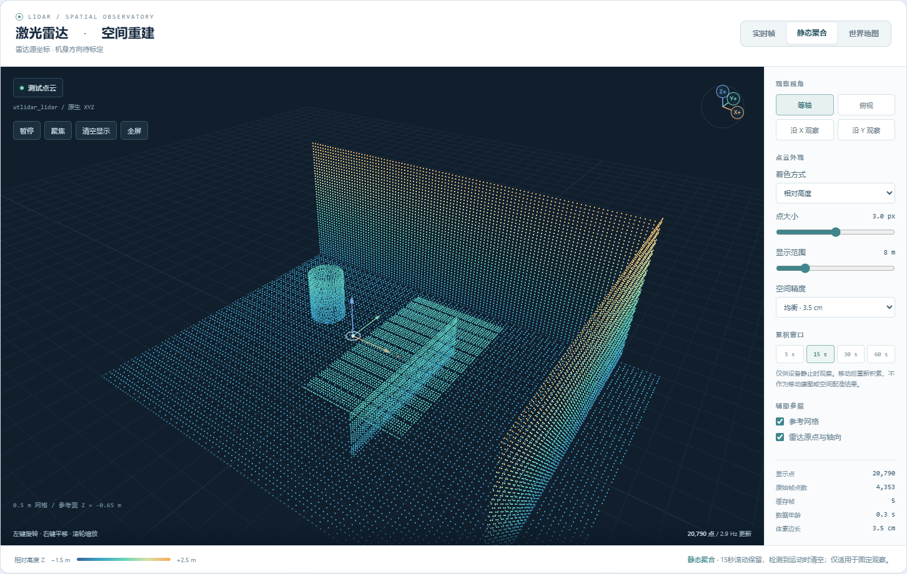

# 点云工作台重构与验收（2026-10-22）

后续方向与世界地图修复已部署，见 [本轮验收](MAPPING_DIRECTION_2026-10-22.md)。本文保留初版状态记录。

部署入口：https://192.168.1.80:8000/ → 视觉与点云 → 激光雷达·空间重建。

## 已交付

- 深色三维视窗、独立浅色控制栏、清晰圆形点渲染、正常深度遮挡；移除伪造的相机 RGB 着色。
- 保留源 XYZ 右手坐标，Three.js 使用 Z-up；坐标方位球与相机联动。移除只旋转方向标签、不旋转点云的 IMU yaw 混用。机身前后左右尚未完成外参验收，页面明确标注。
- 实时帧与静态聚合分开：5/15/30/60 秒窗口、体素去重、帧去重、最多 120000 体素、过期淘汰。默认 8 米范围、3 像素点径、3.5 厘米体素。
- 等轴/俯视/沿 X/沿 Y、聚焦、暂停、清空显示、全屏、网格/轴向，以及高度/距离/强度/时效着色；手机布局适配。
- 请求串行且可取消；切换标签或隐藏页面停止采集；暂停停止请求；掉线清空实时绘制并自动重连。只在数据或相机变化时重绘。
- 后端 PointCloud2 支持组织点云、行填充、大小端、float32/64 字段检查，输出源帧、源时间、接收龄期与运动提示，严格限制响应点数。

## 边界与发现

静态聚合只适用于雷达静止观察，没有位姿配准，不是移动 SLAM。新鲜陀螺仪/速度提示检测到运动时清空累积；该提示不能保证检测到全部移动，数据未知时也不能证明静止。参考网格高度是显示参考，不是已标定地面。

既有世界地图缓存含约 69902 点，出现数十公里 XY、最低约 -327348 米 Z 的异常坐标。新 API 对既有相对地图实施有限坐标检查与 1000 米上限，异常时返回 map_geometry_invalid，不绘制、不自动平移缩放掩盖问题。原缓存保留，世界地图重建仍需定位链路另行修复和验收。有效离线地图可作为明确标记的历史快照查看；不伪造逐点时间。未启动 Point-LIO 或下发运动。

## 验收

- 本地及服务器：21 项 Python 检查通过；本地 8 项点云算法检查通过。
- Headless Chrome：21 项合成场景浏览器检查通过，包括坐标、全屏、聚合、暂停、运动清空、断线重连、隐藏停止、历史地图与异常拦截、手机布局和无脚本/着色器错误。
- 真实服务器浏览器：实时帧 1712 显示点，源帧 utlidar_lidar，Z-up；静态聚合 16 帧/14351 显示点；旧地图异常明确提示，无浏览器错误。点数随真实场景变化。
- 记录见 pointcloud_browser_2026-10-22.json 和 pointcloud_live_2026-10-22.json。下图使用合成测试点云。真实房间截图只保存在本地，不上传原始传感器数据。

## 部署与回滚

运行目录 /mnt/85ee0fe8-b944-40f5-8474-40cc274f0cef/go2w-monitor/；沿用真实服务器已有的其他页面和接口，仅修改点云区域。发布源为 go2w-monitor-release-20261021 工作树；原开发目录有既有未提交修改，未整体覆盖。

保留 server.py.bak_20261021_pcviz、pc_worker.py.bak_20261021_pcviz、web/index.html.bak_20261021_pcviz。恢复这些文件后重启对应 tmux 服务即可回滚。Web 服务必须使用 /home/dell/go2w_vla/.venv/bin/python，系统 Python 缺少 pyarrow；本次误用系统解释器造成短时服务中断，已恢复并完成在线浏览器验收。

运动门禁保持 motion_enabled: false。本轮不要求现场移动、量距或重新摆放目标。

复测：python -m unittest test_cloud_model test_depth_stream test_sensor_freshness；node test_pointcloud_core.js；安装 Playwright 后运行 python tools/test_pointcloud_browser.py --output <输出目录>。针对旧版运行页面可先用 tools/patch_pointcloud_page.py --input <旧HTML> --output <测试HTML>，再将 --html <测试HTML> 传给浏览器检查。升级脚本仅适用于旧版结构，请勿重复应用。
